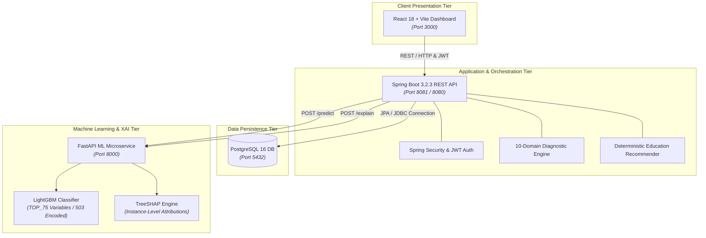

# Explainable Machine Learning-Based Financial Literacy Assessment and Personalized Financial Education System

<p align="center">
  
  <a href="https://doi.org/10.1016/j.techsoc.2024.102797"></a>
  
  
  
</p>

<p align="center">
  
  
  
  
  
  
</p>

<p align="center">
  <b>An end-to-end research platform extending the foundational work of Alex Yue Feng Zhu (2025).</b><br/>
  Combines empirical supervised learning (FINRA NFCS 2024, $N=25,030$), instance-level TreeSHAP feature attribution, and a deterministic personalized pedagogical engine to transform diagnostic predictions into targeted educational intervention.
</p>

<p align="center">
  <a href="#-system-architecture">Architecture</a> •
  <a href="#-key-features">Key Features</a> •
  <a href="#-empirical-research--model-performance">Research & Model</a> •
  <a href="#-quick-start">Quick Start</a> •
  <a href="#-api-endpoints">API Specs</a> •
  <a href="#-citation--references">Citation</a>
</p>

---

> [!IMPORTANT]
> **Research Scope & Ethical Boundaries**:  
> The platform strictly evaluates financial knowledge, behavioral confidence, and pedagogical gaps to provide personalized learning recommendations. The system **does NOT** predict academic eligibility, scholarship status, credit scores, financial need, or poverty. Furthermore, SHAP explanations strictly represent model feature attribution; deterministic pedagogical rules—not raw SHAP values—drive educational module recommendations.

---

## 📑 Table of Contents

- [📌 Research Overview \& Core Motivation](#-research-overview--core-motivation)
- [✨ Key Features](#-key-features)
- [🏗 System Architecture](#-system-architecture)
- [📊 Empirical Research \& Model Performance](#-empirical-research--model-performance)
  - [The 4 Financial Literacy Archetypes](#the-4-financial-literacy-archetypes)
  - [Held-Out Test Set Performance](#held-out-test-set-performance)
  - [TreeSHAP Global Feature Importance](#treeshap-global-feature-importance)
- [🎯 The 10 Financial Literacy Domains](#-the-10-financial-literacy-domains)
- [📁 Repository Structure](#-repository-structure)
- [🚀 Quick Start](#-quick-start)
  - [Prerequisites](#prerequisites)
  - [Docker Compose (Recommended)](#docker-compose-recommended)
  - [Local Development Setup](#local-development-setup)
- [🔌 API Endpoints](#-api-endpoints)
- [🧪 Research Roadmap \& Completed Milestones](#-research-roadmap--completed-milestones)
- [🛡 Citation \& References](#-citation--references)

---

## 📌 Research Overview & Core Motivation

While traditional financial literacy assessments provide static scores, and reference studies primarily focus on offline classification of financial literacy status among youth, our system operationalizes the machine learning pipeline into a complete, **interactive educational feedback loop**:

```
┌────────────────────────────────────────────────────────────────────────────────────────┐
│                                INTERACTIVE FEEDBACK LOOP                               │
│                                                                                        │
│   [ Assessment Engine ] ──────► [ LightGBM Archetype Classifier (TOP_75) ]             │
│            │                                    │                                      │
│            ▼                                    ▼                                      │
│   [ 10-Domain Diagnostics ]            [ TreeSHAP Explainability ]                     │
│            │                                    │                                      │
│            └──────────────┬─────────────────────┘                                      │
│                           ▼                                                            │
│       [ Deterministic Pedagogical Rule Engine ]                                        │
│                           │                                                            │
│                           ▼                                                            │
│       [ Personalized Curriculum & Longitudinal Progress Tracking ]                     │
└────────────────────────────────────────────────────────────────────────────────────────┘
```

1. **Granular Gap Detection**: Objective scoring across 10 discrete financial capability domains.
2. **Behavioral Archetyping**: Identification of mismatches between objective knowledge and subjective confidence (e.g., *Overconfident* vs. *Underconfident*).
3. **Transparent Explainable AI (SHAP)**: Humanized explanations that help learners understand what factors shaped their assessment result without overwhelming them with raw mathematical metrics.
4. **Targeted Pedagogical Action**: Direct mapping from identified weakness domains and archetype profiles to curated educational modules.
5. **Longitudinal Progress Measurement**: Reassessment mechanisms quantifying knowledge gains in percentage points.

---

## ✨ Key Features

| Capability | Description |
| :--- | :--- |
| **🧠 4-Class Archetype Classification** | Identifies cognitive-behavioral profiles (`COMPETENT`, `OVERCONFIDENT`, `UNDERCONFIDENT`, `NAIVE`) from 75 NFCS predictor variables. |
| **🔍 Explainable AI via TreeSHAP** | Calculates signed local Shapley values via `shap.TreeExplainer` on the locked LightGBM model, translating model attribution into user-friendly insights. |
| **🎯 Deterministic Pedagogical Engine** | Implements transparent, rule-based recommendation logic to assign foundational or advanced learning modules tailored to exact knowledge deficits. |
| **📊 Granular 10-Domain Diagnosis** | Evaluates independent mastery across Saving, Budgeting, Interest, Compound Interest, Inflation, Debt, Investment, Risk, Insurance, and Decision-Making. |
| **📈 Longitudinal Progress Tracking** | Stores baseline and post-learning reassessments in PostgreSQL to track empirical learning gains over time. |
| **🐳 Containerized Microservices** | Fully orchestrated multi-service architecture using Docker Compose with automated health checks and isolated networking. |

---

## 🏗 System Architecture

The application adopts a decoupled multi-tier microservices architecture designed for scientific reproducibility, modular scaling, and clear separation of concerns:



### Verified Service Specifications & Ports

| Service | Container Name | Technology Stack | Internal Port | Host Port | Health Check Endpoint |
| :--- | :--- | :--- | :---: | :---: | :--- |
| **Frontend** | `fl_frontend` | React 18, Vite 5, Nginx | `80` | `3000` | Static Dashboard UI |
| **Backend** | `fl_backend` | Spring Boot 3.2.3, Java 21, Gradle | `8080` | `8081` | `GET http://localhost:8081/api/health` |
| **ML Service** | `fl_ml_service` | Python 3.11, FastAPI, LightGBM, SHAP | `8000` | `8000` | `GET http://localhost:8000/health` |
| **Database** | `fl_postgres` | PostgreSQL 16 Alpine | `5432` | `5432` | `pg_isready -U postgres` |

---

## 📊 Empirical Research & Model Performance

### The 4 Financial Literacy Archetypes

By cross-referencing objective financial knowledge against subjective self-assessment, the system defines 4 behavioral archetypes:

| Archetype | Objective Score | Self-Perception | Share ($N=25,030$) | Targeted Educational Focus |
| :--- | :---: | :---: | :---: | :--- |
| **COMPETENT** | **HIGH** | **HIGH** | `43.76%` | Advanced wealth management, market risk, and complex retirement planning. |
| **OVERCONFIDENT** | **LOW** | **HIGH** | `22.86%` | Calibrating assumptions, risk awareness, and foundational debt/interest concepts. |
| **UNDERCONFIDENT** | **HIGH** | **LOW** | `14.99%` | Reinforcing demonstrated skills, building confidence, and practical application. |
| **NAIVE** | **LOW** | **LOW** | `18.39%` | Core financial literacy: budgeting basics, emergency savings, and simple interest. |

---

### Held-Out Test Set Performance

*Evaluated on independent held-out NFCS test partition ($N_{\text{test}} = 3,755$)*:

| Metric | Result | Benchmark Notes |
| :--- | :---: | :--- |
| **Sample Size ($N_{\text{valid}}$)** | **25,030** | FINRA National Financial Capability Study (NFCS 2024) |
| **Predictor Subset** | **75 variables** | 503 one-hot encoded binary features (top mutual-information subset) |
| **Model Classifier** | **LightGBM v1.0.0** | Class-Weighted (`LightGBM_TOP75_ClassWeighted`) |
| **Overall Accuracy** | **`0.5619`** | Evaluated on 4-class multi-classification |
| **Macro Precision** | **`0.5189`** | Unweighted across all 4 classes |
| **Macro Recall** | **`0.5295`** | Unweighted across all 4 classes |
| **Macro F1-Score** | **`0.5205`** | Authoritative multi-class baseline |
| **Weighted F1-Score** | **`0.5721`** | Frequency-weighted composite metric |

#### Per-Class Breakdown

| Class | Precision | Recall | Class F1 |
| :--- | :---: | :---: | :---: |
| **COMPETENT** | 0.7806 | 0.6476 | **0.7079** |
| **OVERCONFIDENT** | 0.4890 | 0.4930 | **0.4910** |
| **UNDERCONFIDENT** | 0.3231 | 0.4103 | **0.3615** |
| **NAIVE** | 0.4828 | 0.5673 | **0.5216** |

---

### TreeSHAP Global Feature Importance

SHAP analysis reveals which categories and variables exert the strongest influence on model classifications across the population:

```
Financial Behavior & Money Management ▓▓▓▓▓▓▓▓▓▓▓▓▓▓▓▓ 29.10%
Demographics & Socioeconomics          ▓▓▓▓▓▓▓▓▓▓▓▓ 22.51%
Financial Education & Assessment      ▓▓▓▓▓▓▓ 14.16%
Credit & Debt Behavior                 ▓▓▓▓▓▓▓ 14.08%
Investing & Retirement                 ▓▓▓▓▓ 10.58%
Saving & Banking                       ▓▓▓▓ 7.73%
Demographics & Geographics             █ 1.23%
Insurance & Protection                 ▌ 0.60%
```

| Rank | NFCS Variable | Feature Description | Mean Abs SHAP | Share % |
| :---: | :--- | :--- | :---: | :---: |
| **1** | `M1_1` | Overall Financial Knowledge (Self-Assessment Scale 1–7) | **0.2803** | **11.50%** |
| **2** | `A50A` | Gender Identity | **0.1202** | **4.93%** |
| **3** | `J1` | Difficulty Covering Monthly Expenses | **0.1039** | **4.26%** |
| **4** | `J8` | Checking Account Overdraft Frequency | **0.0753** | **3.09%** |
| **5** | `A14` | Household Income Volatility / Unexpected Drops | **0.0703** | **2.88%** |

---

## 🎯 The 10 Financial Literacy Domains

The assessment engine diagnoses strengths and weaknesses across 10 core personal finance competencies:

```
┌─────────────────┬─────────────────┬─────────────────┬─────────────────┬─────────────────┐
│   01. SAVING    │  02. BUDGETING  │  03. INTEREST   │ 04. CMPD. INT.  │  05. INFLATION  │
├─────────────────┼─────────────────┼─────────────────┼─────────────────┼─────────────────┤
│    06. DEBT     │ 07. INVESTMENT  │    08. RISK     │  09. INSURANCE  │ 10. DECISIONS   │
└─────────────────┴─────────────────┴─────────────────┴─────────────────┴─────────────────┘
```

- **01. Saving**: Emergency reserves, liquid savings ratio, and short-term buffering.
- **02. Budgeting**: Cash flow allocation, expense tracking, and discretionary controls.
- **03. Interest Rates**: APR fundamentals, simple interest calculations, and borrowing costs.
- **04. Compound Interest**: Exponential growth mechanics and long-term interest accrual.
- **05. Inflation**: Purchasing power erosion and real versus nominal returns.
- **06. Debt Management**: Credit utilization, high-interest debt prioritization, and payoff strategies.
- **07. Investment Fundamentals**: Asset classes (stocks, bonds, mutual funds, ETFs) and capital growth.
- **08. Risk & Diversification**: Portfolio allocation, volatility tolerance, and unsystematic risk mitigation.
- **09. Insurance & Protection**: Risk transference, deductibles, premiums, and catastrophe protection.
- **10. Financial Decision-Making**: Evaluating tradeoffs, opportunity costs, and financial contract scrutiny.

---

## 📁 Repository Structure

```
├── frontend/                     # React 18 + Vite Single Page Application
│   ├── src/
│   │   ├── api/                  # Axios HTTP client configured for backend
│   │   ├── components/           # Reusable UI components & navigation
│   │   ├── pages/                # Assessment, Results, Education & Dashboard views
│   │   ├── index.css             # Vanilla CSS design system
│   │   └── App.jsx               # Client-side routing & layouts
│   └── Dockerfile                # Multi-stage production Nginx container
│
├── backend/                      # Spring Boot 3.2 REST API Backend (Java 21)
│   ├── src/main/java/com/financialliteracy/
│   │   ├── config/               # Security, CORS & WebClient configurations
│   │   ├── controller/           # REST controllers (Auth, Assessment, Education, ML)
│   │   ├── dto/                  # Request / Response transfer objects
│   │   ├── entity/               # JPA domain entities (User, Assessment, Question, etc.)
│   │   ├── repository/           # Spring Data JPA repositories
│   │   └── service/              # Assessment, Diagnostic, ML & Education engine logic
│   ├── src/main/resources/
│   │   ├── db/migration/         # Flyway schema & data seed migrations (V1-V5)
│   │   └── application.yml       # Service configuration & ML bridge timeouts
│   └── build.gradle              # Gradle build script & dependencies
│
├── ml-service/                   # Python 3.11 FastAPI Machine Learning Microservice
│   ├── app/                      # FastAPI application routes, schemas & services
│   ├── models/                   # Serialized LightGBM & TreeSHAP model artifacts
│   ├── Dockerfile                # Container definition with Python 3.11 slim
│   └── requirements.txt          # Python dependencies (FastAPI, LightGBM, SHAP, scikit-learn)
│
├── research/                     # Empirical research artifacts & reproduction code
│   ├── dataset/                  # Anonymized NFCS survey microdata
│   ├── notebooks/                # Model exploration, tuning & SHAP generation notebooks
│   ├── final/                    # Authoritative research documentation & metric tables
│   └── experiments/              # Cross-validation records and hyperparameter logs
│
├── docs/                         # Technical specifications and API documentation
│   ├── architecture/             # System topology and domain model specs
│   ├── api/                      # OpenAPI & REST endpoint specifications
│   ├── education-engine.md       # Pedagogical recommendation rule specifications
│   ├── ml-integration.md         # Spring Boot ↔ FastAPI HTTP bridge contract
│   └── docker-e2e-verification.md# End-to-end container test verification
│
├── docker-compose.yml            # Complete multi-container orchestration
├── .env.example                  # Environment variable template
└── README.md                     # Project documentation
```

---

## 🚀 Quick Start

### Prerequisites

- [Docker Desktop](https://www.docker.com/products/docker-desktop/) 24+ & Docker Compose v2+
- *(Optional for bare-metal development without Docker)*:
  - JDK 21 LTS
  - Python 3.11+
  - Node.js 18+
  - PostgreSQL 16+

---

### Docker Compose (Recommended)

The easiest way to launch the complete system with all 4 services connected is via Docker Compose:

1. **Clone the repository**:
   ```bash
   git clone https://github.com/your-username/financial-literacy-system.git
   cd financial-literacy-system
   ```

2. **Configure environment variables (optional)**:
   ```bash
   cp .env.example .env
   ```

3. **Build and launch all services**:
   ```bash
   docker compose build
   docker compose up -d
   ```

4. **Verify container health**:
   ```bash
   docker compose ps
   ```

5. **Access the application**:
   - 🌐 **Web Dashboard**: [`http://localhost:3000`](http://localhost:3000)
   - ☕ **Spring Boot Health**: [`http://localhost:8081/api/health`](http://localhost:8081/api/health)
   - 🐍 **FastAPI ML Health**: [`http://localhost:8000/health`](http://localhost:8000/health)
   - 🐘 **PostgreSQL**: `localhost:5432` (`financial_literacy_db`)

---

### Local Development Setup

<details>
<summary><b>Click to expand bare-metal local instructions (without Docker)</b></summary>

#### 1. PostgreSQL Database
Ensure a PostgreSQL 16 instance is running locally:
```sql
CREATE DATABASE financial_literacy_db;
CREATE USER postgres WITH ENCRYPTED PASSWORD 'postgres_secure_pass_2026';
GRANT ALL PRIVILEGES ON DATABASE financial_literacy_db TO postgres;
```

#### 2. Python ML Service
```bash
cd ml-service
python -m venv venv
# Windows:
venv\Scripts\activate
# Linux/macOS:
# source venv/bin/activate
pip install -r requirements.txt
uvicorn app.main:app --host 0.0.0.0 --port 8000 --reload
```

#### 3. Spring Boot Backend
```bash
cd backend
# Windows:
gradlew.bat bootRun
# Linux/macOS:
# ./gradlew bootRun
```

#### 4. React Frontend
```bash
cd frontend
npm install
npm run dev
```

</details>

---

## 🔌 API Endpoints

### Spring Boot Backend (`http://localhost:8081/api`)

| Method | Endpoint | Description |
| :--- | :--- | :--- |
| `GET` | `/api/health` | Comprehensive system health (DB + ML service connectivity) |
| `POST` | `/api/auth/register` | Register a new learner account |
| `POST` | `/api/auth/login` | Authenticate and obtain JWT bearer token |
| `GET` | `/api/questions` | Fetch diagnostic assessment question inventory |
| `GET` | `/api/categories` | Fetch 10 financial literacy domain definitions |
| `POST` | `/api/assessments` | Submit completed assessment responses |
| `GET` | `/api/assessments/{id}/result` | Fetch calculated scores, archetype, and weak areas |
| `GET` | `/api/assessments/{id}/education` | Fetch personalized pedagogical recommendations |
| `POST` | `/api/financial-literacy/explain` | Proxy user features for instance-level SHAP explanation |

### Python ML Service (`http://localhost:8000`)

| Method | Endpoint | Description |
| :--- | :--- | :--- |
| `GET` | `/health` | Model status, version, and memory health |
| `POST` | `/predict` | Predicts archetype (`COMPETENT`, `OVERCONFIDENT`, etc.) and probabilities |
| `POST` | `/explain` | Returns TreeSHAP feature attributions and base values |

---

## 🧪 Research Roadmap & Completed Milestones

- [x] **Phase 1 — Monorepo Architecture & Multi-Service Setup**
- [x] **Phase 2 — Domain Model & PostgreSQL Relational Schema (Flyway V1–V5)**
- [x] **Phase 3 — Assessment & Dynamic Question Engine**
- [x] **Phase 4A — FINRA NFCS Dataset Audit & Target Variable Definition**
- [x] **Phase 5 — Baseline Supervised ML Experiments**
- [x] **Phase 6A — Class Imbalance Handling (Inverse Frequency Weighting)**
- [x] **Phase 6B — LightGBM Hyperparameter Optimization Grid**
- [x] **Phase 6C — Mutual-Information Feature Selection (`TOP_75`)**
- [x] **Phase 6D — Instance & Global TreeSHAP Explainability**
- [x] **Phase 7A — Model Packaging & FastAPI Microservice Delivery**
- [x] **Phase 7B — Spring Boot ↔ FastAPI HTTP Bridge Integration**
- [x] **Phase 7C — SHAP Feature Attribution REST Endpoints**
- [x] **Phase 7D — Deterministic Rule-Based Personalized Education Engine**
- [x] **Phase 7E — React Dashboard for Explainable Results & Learning Paths**
- [x] **Phase 7F — Multi-Container Docker Compose Orchestration & E2E Verification**
- [x] **Phase 7H — Authoritative Research Package Freeze & Documentation**

---

## 🛡 Citation & References

If you use or build upon this research platform, please cite the foundational research paper and reference the dataset:

### Academic Citation
> Zhu, A. Y. F. (2025). Unlocking financial literacy with machine learning: A critical step to advance personal finance research and practice. *Technology in Society*, 102797. [https://doi.org/10.1016/j.techsoc.2024.102797](https://doi.org/10.1016/j.techsoc.2024.102797)

### BibTeX
```bibtex
@article{zhu2025unlocking,
  title={Unlocking financial literacy with machine learning: A critical step to advance personal finance research and practice},
  author={Zhu, Alex Yue Feng},
  journal={Technology in Society},
  volume={80},
  pages={102797},
  year={2025},
  publisher={Elsevier},
  doi={10.1016/j.techsoc.2024.102797}
}
```

### Dataset Attribution
> **FINRA Investor Education Foundation (2024)**. *National Financial Capability Study (NFCS)*. Anonymized microdata accessed for research purposes under FINRA terms of use.
